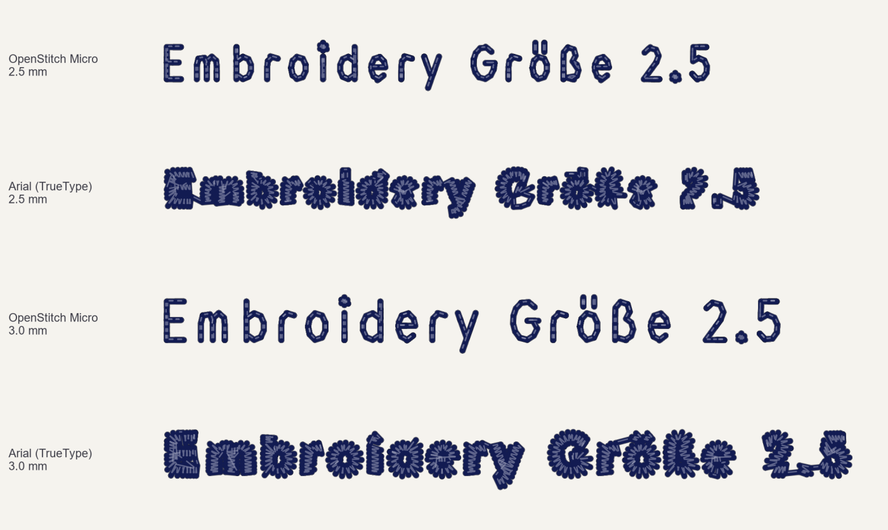

# 🪡 OpenStitch Studio

🌐 **Language / Sprache:** **English** · [Deutsch](./README.de.md) · [Français](./README.fr.md) · [Español](./README.es.md)

**Universal Open-Source Embroidery & Digitizing Suite for Windows, macOS & Linux**

[](./LICENSE)
[](https://www.python.org/)
[](#-quickstart--installation)
[](./CONTRIBUTING.md)

**OpenStitch Studio** is a modern, open-source embroidery digitizing suite with an eye-friendly **dark studio interface**, real-time 3D thread preview, a smart **Auto-Digitizer**, **PhotoStitch**, real **thread catalogs** (Madeira, Isacord, Gunold, Brother) and a **UI in 4 languages** (English, Deutsch, Français, Español). It supports all common home and industrial embroidery machines (**Tajima, Brother, Barudan, Ricoma, ZSK, Janome, Bernina, Pfaff/Husqvarna, Melco**).

> 💬 **Feedback & contributions welcome!**
> This project thrives on real-world feedback from many different embroidery machines and on community contributions. Found a bug, have an idea, or want to help build it? Open an [Issue](https://github.com/lb2002/openstitch/issues) or a [Pull Request](./CONTRIBUTING.md)!


<details>
<summary><b>🔍 Preview: interactive in-app studio tour (spotlight & coach marks)</b></summary>
<br>


</details>

---

## ✨ Highlights & Features

### 1. 🪄 Smart Auto-Digitizer (image / logo → embroidery file)
* **Perceptual colour reduction in CIE-Lab** + automatic matching to real thread catalogs (**Madeira Polyneon 40, Isacord 40, Gunold Poly 40, Brother, Universal**).
* **Edge flood-fill background removal:** removes the background but keeps same-coloured inner details (e.g. white lettering in a logo).
* **Automatic stitch-type classification** via medial-axis skeleton & distance transform:
  * thin lines → **triple / bean run**
  * lettering & columns → **auto satin** with smoothly rotating stitch angle, short-stitching on tight inner curves, split satin for wide columns and automatic underlay
  * large areas → **tatami fill** or curved **contour fill** with boustrophedon region splitting, hidden travel routing along the outline, edge/lattice underlay and directional pull compensation
* **Colour trap vs. smart knockdown + 0.7 mm overlap lip:** avoids bullet-proof stacking while eliminating fabric gaps between adjacent colours.
* **Fabric presets:** standard, piqué/polo/knit, terry/towel, caps, lightweight.
* **Drag & drop:** drop images (`.png`, `.jpg`, `.webp`), `.svg` vectors or embroidery files straight onto the window.

### 2. 🎨 Manual digitizing, node editor & pro tools
* **Direct tools:** tatami (`F`), satin (`S`), running/bean stitch (`R`) and an interactive **node editor (`N`)**.
* **Parametric live inspector:** every object stays fully editable; scaling recalculates stitch density.
* **3D puff foam mode (caps):** dense satin (0.24 mm) with perforating pinch end-caps for 2–3 mm foam.
* **1-click appliqué:** placement line (with stop), tack-down and satin cover border.
* **PhotoStitch:** portrait/landscape photos → monochrome, sepia or 4-colour CMYK wave embroidery.
* **Satin columns along your drawn centre line** (`S`): stitches stay perpendicular to the line, with adjustable width, short stitches on tight curves, corner handling and automatic underlay (centre walk / edge walk / zigzag, chosen by column width).
* **OpenStitch Micro: small lettering from 2.5 mm.** A built-in single-stroke embroidery font, stitched like commercial small-text fonts. TrueType outlines fill in below ~4.5 mm; Micro stays readable:

  
* **SVG import** (transforms, arcs, styles, `<use>`, fill rules) & **TTF/OTF lettering** (arc text, automatic satin/tatami choice).

### 3. 🩺 Density guard, heatmap & quality doctor (`F7`)
* **Anti-thread-break filter** prevents needle collisions, bird-nesting and fabric holes.
* **Live stitch-density heatmap** (green / yellow / red).
* **Quality doctor:** checks hoop clearance, needle count, micro-stitches and trims before export.
* **Binary verification on export:** every exported file is re-read by an independent parser and checked for size and geometry.

### 4. 🌍 Languages & real thread catalogs
* **UI languages:** 🇬🇧 English · 🇩🇪 Deutsch · 🇫🇷 Français · 🇪🇸 Español — switch live at the top of the window.
* **Thread catalogs with official colour numbers:** Madeira Polyneon No. 40, Isacord Polyester No. 40, Gunold POLY 40, Brother Embroidery and a universal palette; custom CSV palettes can be loaded too.

### 5. 🏭 Manufacturer-neutral & all major machine formats
* **Built-in machine profiles & hoop strategies:** Universal (`.DST` / `.PES` / `.EXP`), **Tajima** (`.DST`), **Brother** (`.PES` / `.PEC`), **Barudan** (`.U01` / `.DST`), **Ricoma / HappyJapan / ZSK** (`.DST`), **Janome / Elna / Bernina** (`.JEF` / `.EXP`), **Pfaff / Husqvarna Viking** (`.VP3`), **Melco** (native `.EXP`, built-in 1.44 MB FAT12 `.IMG` GoTek/FlashFloppy manager and an optional Raspberry Pi Wi-Fi bridge in `melco_netbridge/`).
* **Smart hoop strategies:** underlay, pull compensation and stitch order adapt to small hoops, standard hoops, jacket backs and curved cap frames (*centre-out & bottom-up*).
* **A4 PDF production sheet:** needle assignment, thread usage, stitch count and runtime estimate.

---

## 🚀 Quickstart & Installation

### Option A: 1-click download (no Python required)
Get the ready-made app from the **[GitHub release page (v0.2.0)](https://github.com/lb2002/openstitch/releases/tag/v0.2.0)**:
* 🪟 **Windows (64-bit, single file):** [`OpenStitch-Studio-Windows-x64.exe`](https://github.com/lb2002/openstitch/releases/download/v0.2.0/OpenStitch-Studio-Windows-x64.exe) *(download & double-click, nothing to unpack)*
* 🍏 **macOS (Apple Silicon M1 / M2 / M3 / M4):** [`OpenStitch-Studio-macOS-AppleSilicon-M-Chip-arm64.zip`](https://github.com/lb2002/openstitch/releases/download/v0.2.0/OpenStitch-Studio-macOS-AppleSilicon-M-Chip-arm64.zip)
* 🍎 **macOS (Intel x64):** [`OpenStitch-Studio-macOS-Intel-x64.zip`](https://github.com/lb2002/openstitch/releases/download/v0.2.0/OpenStitch-Studio-macOS-Intel-x64.zip)

### Option B: run from source (Windows, macOS & Linux)
Requires **Python 3.10+**.

```bash
git clone https://github.com/lb2002/openstitch.git
cd openstitch
python -m venv .venv
# Windows:  .venv\Scripts\pip install -e .   &&   .venv\Scripts\python.exe main.py
# macOS/Linux:
.venv/bin/pip install -e .
.venv/bin/python main.py
```

On first launch you are greeted by the official **OpenStitch emblem** in the hoop and an interactive **7-step in-app tour** (reopen any time with `F1`).

---

## 🗂️ Project layout

```text
openstitch/
├── openstitch/
│   ├── auto/          # CIE-Lab colour reduction, Auto-Digitizer, PhotoStitch & thread catalogs
│   ├── core/          # design model, stitch plan, hoop & machine profiles
│   ├── engine/        # geometry, tatami/contour fill, satin, 3D puff, appliqué, density guard
│   ├── io/            # DST, PES, EXP, JEF, VP3, U01 import/export, FAT12 generator, PDF report
│   ├── text/          # TTF/OTF vector lettering engine & arc text
│   ├── ui/            # Material 3 dark studio GUI, 3D canvas, dialogs & onboarding
│   └── i18n.py        # UI translations (EN / DE / FR / ES)
├── melco_netbridge/   # optional Wi-Fi USB-emulator server (e.g. Raspberry Pi Zero 2 W)
└── tests/             # automated pytest suite
```

---

## 🤝 Contributing & feedback

* 🌟 **Star the repo** if you like OpenStitch Studio!
* 🐛 **Bug reports & machine tests:** open a [GitHub Issue](https://github.com/lb2002/openstitch/issues) and tell us which machine you use.
* 🌐 **Translations:** add or improve a language in [`openstitch/i18n.py`](./openstitch/i18n.py).
* 🔧 **Pull requests:** see [CONTRIBUTING.md](./CONTRIBUTING.md).

---

## 📜 License & copyright

Copyright © 2026 **Linus Baumberger** ([@lb2002](https://github.com/lb2002)).

* **Open-source copyleft:** released under the **[GNU AGPL-3.0-or-later](./LICENSE)**. Anyone may use, study, improve and share the software for free; derivative works and network/cloud services must stay open under the same licence.
* **Commercial / dual licensing:** as original author and copyright holder, **Linus Baumberger (`@lb2002`)** reserves the right to additionally offer OpenStitch Studio under commercial / OEM licences. See [LICENSE](./LICENSE).
