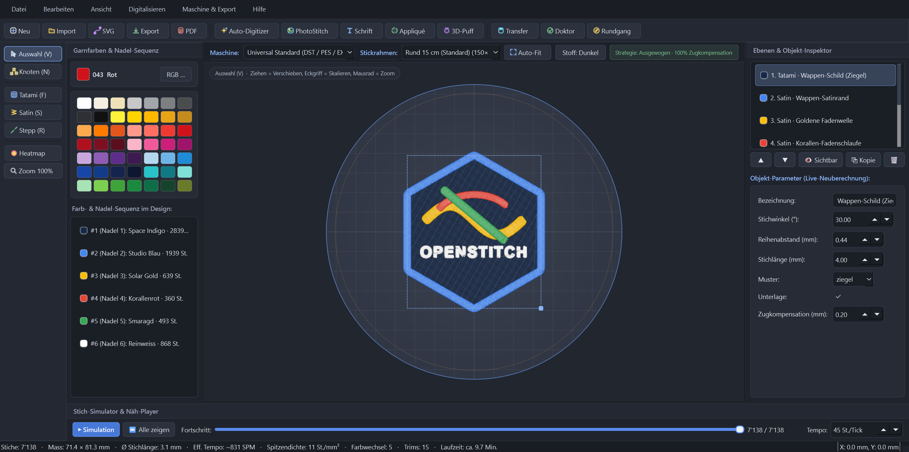
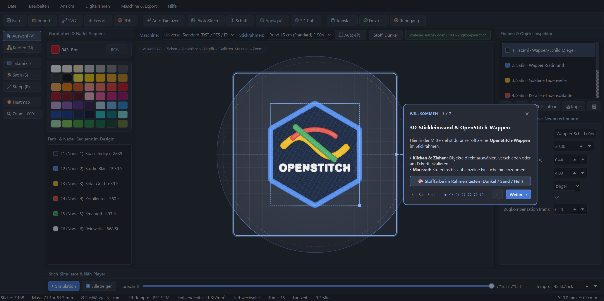

# 🪡 OpenStitch Studio

**Universal Open-Source Embroidery & Digitizing Suite for Windows, macOS & Linux**

[](./LICENSE)
[](https://www.python.org/)
[](#quickstart--installation)
[](./CONTRIBUTING.md)

**OpenStitch Studio** ist eine moderne, quelloffene Stick- und Digitalisiersoftware (Digitizing Suite) mit einem augenschonenden **Dark-Studio-Interface**, Echtzeit-3D-Seidenglanz-Vorschau, intelligentem **Auto-Digitizer**, **PhotoStitch** und nativer Unterstützung für alle gängigen Haushalts- und Industrie-Stickmaschinen (**Tajima, Brother, Barudan, Ricoma, ZSK, Janome, Bernina, Pfaff/Husqvarna, Melco**).

> 💬 **Feedback & Mitarbeit erwünscht!**  
> Dieses Projekt lebt von echtem Praxis-Feedback an verschiedensten Stickmaschinen und von Community-Beiträgen. Wenn du Ideen, Wünsche oder Bugs findest oder selbst mitentwickeln möchtest: Erstelle gerne ein [Issue](https://github.com/lb2002/openstitch/issues) oder einen [Pull Request](./CONTRIBUTING.md)!



<details>
<summary><b>🔍 Vorschau: Interaktiver In-App Studio-Rundgang (Spotlight & Coach-Marks)</b></summary>
<br>



</details>

---

## ✨ Highlights & Features

### 1. 🪄 Intelligenter Auto-Digitizer (Bild / Logo → Stickdatei)
* **Wahrnehmungstreue Farbreduktion im CIE-Lab-Farbraum** + automatisches Matching auf echte Stickgarn-Paletten (Madeira / Isacord / Universal).
* **Rand-Flood-Fill Hintergrund-Erkennung:** Entfernt den Bildhintergrund automatisch, lässt aber gleichfarbige Innendetails (z. B. weiße Schrift im Logo) unangetastet.
* **Automatische Stichart-Klassifikation per Medial-Axis-Skelett & Distanztransformation:**
  * Feine Konturen → **Dreifach-/Beanstich**
  * Schriften & Säulen → **Auto-Satinstich** mit fließend mitdrehendem Stichwinkel, Kurzstichen (Short-Stitches) in engen Innenkurven, Split-Satin bei breiten Säulen und automatischer Unterlage
  * Große Flächen → **Tatami-Füllstich** oder **gebogener Kontur-Füllstich (Contour Fill)** mit Boustrophedon-Abschnittszerlegung, unsichtbarem Travel-Routing entlang der Außenkante, Kanten-/Gitter-Unterlage und richtungsabhängiger Zugkompensation (Pull Compensation)
* **Color-Trap vs. Smart Knockdown + 0.7 mm Überlappungslinie:** Verhindert einerseits brettharte Doppellagen („Bulletproof Embroidery“) und andererseits weiße Stoffblitzer (Passerlücken) zwischen angrenzenden Farbflächen.
* **Stoffprofile:** Standard (Baumwolle/Twill), Piqué/Polo/Strick, Frottee/Handtuch, Kappe/Cap, Leichter Stoff.
* **Drag & Drop:** Ziehe Bilder (`.png`, `.jpg`, `.webp`), `.svg`-Vektorgrafiken oder Stickdateien direkt aus dem Explorer/Finder ins Programmfenster.

### 2. 🎨 Manuelles Digitalisieren, Knoten-Editor & Pro-Werkzeuge
* **Direkt-Werkzeuge:** Tatami-Fläche (`F`), Satin-Säule (`S`), Lauf-/Dreifachstich (`R`) und **Interaktiver Knoten-Editor (`N`)** direkt auf der Leinwand.
* **Parametrischer Live-Inspektor:** Jedes Objekt bleibt vollständig editierbar (Reihenabstand, Stichlänge, Winkel, Kontur-Füllung, Zugkompensation, Unterlage, Ein-/Ausstich-Einkürzung). Beim Skalieren wird die Stichdichte automatisch neu berechnet.
* **3D-Puff-Schaumstoff-Modus (für Caps):** Erzeugt hochdichte Satin-Säulen (0.24 mm) mit speziell perforierenden **Pinch-End-Caps** zum sauberen Durchtrennen von 2–3 mm 3D-Stick-Schaumstoff.
* **1-Klick Applikation (Appliqué):** Erzeugt automatisch Platzierungslinie (mit Maschinen-Stopp), Stoff-Fixiernaht (Tack-Down) und breite Satin-Deckkante.
* **PhotoStitch:** Verwandelt Porträt- und Landschaftsfotos in Monochrom-, Sepia- oder 4-Farb-CMYK-Wellenstickerei.
* **SVG-Vektor-Import & TTF/OTF-Schrift-Generator** (inkl. Bogentext & automatischer Satin/Tatami-Wahl).

### 3. 🩺 Stichdichte-Wächter, Heatmap & Qualitäts-Doktor (`F7`)
* **Automatischer Anti-Fadenbruch-Filter (`density_guard`):** Verhindert Nadelkollisionen, Fadennester („Birdnesting“) und Stofflöcher.
* **Live-Stichdichte-Heatmap:** Zeigt kritische Dichtestellen farbcodiert (Grün / Gelb / Rot) auf der Leinwand.
* **Qualitäts-Doktor (`F7`):** Prüft vor dem Export Rahmen-Sicherheitsabstand, Nadelanzahl, Kurzstich-Spitzen und Fadenschnitte.

### 4. 🏭 Herstellerneutral & Alle wichtigen Maschinenformate
* **Integrierte Maschinenprofile & Rahmen-Strategien:**
  * Universal Standard (`.DST` / `.PES` / `.EXP`)
  * **Tajima** (TME / TMF / TMFD / TMBP — `.DST`)
  * **Brother** (PR-Serie Mehrnadel & Innov-is Haushalt — `.PES` / `.PEC`)
  * **Barudan** (BEMR / BEXY / BEKT — `.U01` / `.DST`)
  * **Ricoma / HappyJapan / ZSK** (`.DST`)
  * **Janome / Elna / Bernina** (`.JEF` / `.EXP`)
  * **Pfaff / Husqvarna Viking** (`.VP3`)
  * **Melco** (EMT10/4, Amaya, Bravo — nativer `.EXP`-Generator + eingebauter 1.44 MB FAT12 `.IMG` GoTek/FlashFloppy-Diskettenmanager & optionales Raspberry-Pi WLAN-NetBridge-Modul in `melco_netbridge/`).
* **Intelligente Rahmen-Strategien:** Passt Unterlage, Zugkompensation und Stickreihenfolge automatisch an kleine Hemdrahmen, Standardrahmen, Jackenrücken oder gebogene Kappenrahmen (*Center-Out & Bottom-Up*) an.
* **A4-PDF-Produktionsblatt:** Exportiert ein druckfertiges Produktions- & Einrichteblatt mit Nadelbelegung, Garnverbrauch, Stichzahl und Laufzeitschätzung.

---

## 🚀 Quickstart & Installation

### Option A: 1-Klick Windows Portable Download (ohne Python-Installation!)
Lade dir einfach das fertige Paket **`OpenStitch-Studio-v0.1.0-Windows-x64.zip`** von den **[GitHub Releases (v0.1.0)](https://github.com/lb2002/openstitch/releases/tag/v0.1.0)** herunter, entpacke es und starte **`OpenStitch-Studio.exe`** per Doppelklick!

---

### Option B: Aus dem Quellcode starten (Windows, macOS & Linux)
* Voraussetzung: **Python 3.10+**

### 1. Repository klonen & starten

#### Windows
Doppelklicke auf **`start_windows.bat`** (richtet beim ersten Start automatisch die virtuelle Umgebung `.venv` ein) — oder im Terminal:
```powershell
git clone https://github.com/lb2002/openstitch.git
cd openstitch
python -m venv .venv
.venv\Scripts\pip install -e .
.venv\Scripts\python.exe main.py
```

#### macOS / Linux
Doppelklicke auf **`start_macos.command`** (`chmod +x start_macos.command`) — oder im Terminal:
```bash
git clone https://github.com/lb2002/openstitch.git
cd openstitch
python3 -m venv .venv
.venv/bin/pip install -e .
.venv/bin/python main.py
```

Beim ersten Start begrüßt dich **OpenStitch Studio** mit dem offiziellen **OpenStitch-Emblem** im Stickrahmen und einem interaktiven **7-Schritte In-App Studio-Rundgang** (jederzeit wieder aufrufbar über `Hilfe` → `Interaktiven Studio-Rundgang starten (F1)`).

---

## 🗂️ Projekt-Architektur

```text
openstitch/
├── openstitch/
│   ├── auto/          # CIE-Lab Farbreduktion, Auto-Digitizer, PhotoStitch & Garnpaletten
│   ├── core/          # Design-Datenmodell, Stichplan, Rahmenprofile & Maschinenprofile
│   ├── engine/        # Geometrie, Tatami/Contour-Fill, Satin-Säulen, 3D-Puff, Appliqué, Density-Guard
│   ├── io/            # Exporter/Importer (DST, PES, EXP, JEF, VP3, U01), FAT12-Generator, PDF-Report
│   ├── text/          # TTF/OTF Vektor-Schrift-Engine & Bogentext
│   └── ui/            # Google Material 3 Dark-Studio GUI, 3D-Canvas, Dialoge & In-App-Onboarding
├── melco_netbridge/   # Optionaler WLAN-USB-Emulator-Server (z. B. für Raspberry Pi Zero 2 W)
└── tests/             # Automatisierte Pytest-Testsuite
```

---

## 🤝 Mitmachen & Feedback (Contributing)

Wir freuen uns riesig über jedes Feedback aus der Stick- und Maker-Community:
* 🌟 **Gib dem Repo einen Star**, wenn dir OpenStitch Studio gefällt!
* 🐛 **Bug-Reports & Maschinen-Tests:** Öffne ein [GitHub Issue](https://github.com/lb2002/openstitch/issues) und schreib gern dazu, mit welcher Stickmaschine du arbeitest.
* 🔧 **Pull Requests:** Lies unsere [CONTRIBUTING.md](./CONTRIBUTING.md) für Details zum Setup und zur Beitragsvereinbarung.

---

## 📜 Lizenz & Urheberrecht (License)

Copyright © 2026 **Linus Baumberger** ([@lb2002](https://github.com/lb2002)).

* **Open-Source Copyleft Lizenz:** Dieses Projekt ist unter der **[GNU Affero General Public License v3.0 (AGPL-3.0-or-later)](./LICENSE)** veröffentlicht. Jeder darf die Software kostenlos nutzen, studieren, verbessern und teilen. Jegliche Weiterentwicklungen, abgeleitete Werke oder Netzwerk-/Cloud-Dienste müssen unter derselben Lizenz quelloffen bleiben – ein unbefugtes Verkaufen als geschlossene/proprietäre Software durch Dritte ist ausgeschlossen.
* **Kommerzielle / Dual-Lizenzierung:** Als ursprünglicher Erfinder und Urheberrechtsinhaber behält sich **Linus Baumberger (`@lb2002`)** das Recht vor, OpenStitch Studio (oder Teile davon) zusätzlich unter kommerziellen / OEM-Lizenzen anzubieten. Für kommerzielle Anfragen oder Partnerschaften siehe [LICENSE](./LICENSE).
